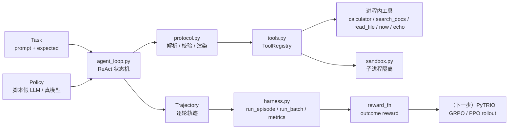

# 接下来我将复现 10 篇强化学习算法：第 9 篇，无 GPU 也能把 Harness-RL 拆开

> 想跳过正文直接运行？请查看 [快速启动指南](./start.md)：`python demo.py` + `python -m pytest tests -q`，无 GPU、无 API key、无第三方运行时依赖。

> **编号说明**：根 README 第 41 行写的是「第十篇，我会做 Harness-RL 的复现和拆解」。仓库现有编号目录是 `00-08`，所以本文顺着落在 [`09-harness/`](./)。根 README 的目录表没有在本轮改动（避免把「新增一篇教程」和「改首页」混在同一次改动里），等这一篇稳定后再单独补一行。

> **代码与复现资源**
>
> - 本文完整代码：[agentic-rl-lab/09-harness](https://github.com/KMnO4-zx/agentic-rl-lab/tree/main/09-harness)
> - 快速启动：[start.md](./start.md)
> - 架构图是 mermaid（GitHub 原生渲染，见「Harness 的 8 个组件」一节）；`images/` 目录预留给封面与截图
> - 参考：veRL `AgentLoop`、OpenHands runtime、SWE-agent ACI、ReTool（本系列第 5 篇）

这是「接下来我将复现 10 篇强化学习算法」系列的第九个编号目录。

前面几篇分别讲了：

- [第 0 篇：强化学习基础——损失函数](./../00-loss-function/readme.md)
- [第 1 篇：GRPO](./../01-grpo/readme.md)
- [第 2 篇：OPD](./../02-opd/readme.md)
- [第 3 篇：Search-R1](./../03-search-r1/readme.md)
- [第 4 篇：OPSD](./../04-opsd/readme.md)
- [第 5 篇：ReTool](./../05-retool/readme.md)
- [第 6 篇：DAPO](./../06-dapo/readme.md)
- [第 7 篇：GSPO](./../07-gspo/readme.md)
- [第 8 篇：ALFWorld](./../08-alfworld/readme.md)

前面每一篇的 rollout 都是「一次生成 + 一个 reward」。从 ReTool、Search-R1 开始，模型会**停下来调工具、看结果、再继续想**——这时真正决定训练能不能跑起来的，往往不是 loss 公式，而是包在 loss 外面的那一层工程：**harness**。

这一篇要做的事情很具体：**用两千多行标准库代码，把 Harness-RL 里最关键的 8 个组件从零写一遍、跑通、测一遍**，并且在没有 GPU、没有 API key 的机器上就能看到完整轨迹。

---

## 先看结果

`python demo.py` 跑完三个用例，全部通过：

```text
part 1/3 · single episodes (scripted fake LLM)

--- [1/3] calc-chain ---
  turn 01 | tool    | calculator({"expression": "(12 + 30) * 2"}) -> 84
  turn 02 | tool    | calculator({"expression": "84 / 2"}) -> 42
  turn 03 | answer  | 42
  reward=1.00 solved=True terminated_by=answer turns=3 tool_calls=2 errors=(protocol=0, tool=0)

--- [2/3] docs-lookup ---
  turn 01 | tool    | search_docs({"query": "execution isolation timeout", "top_k": 2}) -> [doc-1] Sandbox ...
  turn 02 | tool    | read_file({"path": "workspace/notes.md", ...}) -> # Harness-RL 工作区笔记 ...
  turn 03 | answer  | sandbox
  reward=1.00 solved=True terminated_by=answer turns=3 tool_calls=2 errors=(protocol=0, tool=0)

--- [3/3] resilience ---
  turn 01 | tool    | multiply({"a": 6, "b": 7}) -> Error [unknown_tool]: ...  [error=unknown_tool]
  turn 02 | invalid | error=invalid_json -> [protocol-error:invalid_json] tool call is not valid JSON...
  turn 03 | tool    | run_python({"code": "print(6 * 7)"}) -> 42
  turn 04 | answer  | 42
  reward=1.00 solved=True terminated_by=answer turns=4 tool_calls=2 errors=(protocol=1, tool=1)
```

批量 rollout 与 SwanLab 风格指标：

```text
part 2/3 · batch rollout (ThreadPoolExecutor)
episodes=6 batch_wall_time=0.045s
------------------------------------
episodes                         6
solved                           6
solved_rate                 100.0%
avg_reward                   1.000
avg_turns                     3.33
tool_calls                      12
protocol_errors                  2
tool_errors                      2
------------------------------------
{"harness/episodes": 6.0, "harness/reward": 1.0, "harness/solved_rate": 1.0,
 "harness/avg_turns": 3.33, "harness/tool_calls": 12.0,
 "harness/protocol_errors": 2.0, "harness/timeouts": 0.0, ...}
```

沙箱子进程边界（超时 / 截断 / 退出码 / UTF-8）：

```text
part 3/3 · sandbox boundary checks
[PASS] normal stdout          child says 42
[PASS] utf-8 output           沙箱-中文-ok
[PASS] timeout is killed      timed_out=True latency=0.76s
[PASS] output truncated       truncated=True chars=4096
[PASS] non-zero exit code     ok=False returncode=3

demo finished: all checks passed
```

测试：

```text
$ python -m pytest tests -q
........................................................................ [ 66%]
....................................                                     [100%]
108 passed
```

---

## 为什么 Agent RL 需要一个 Harness？

在单轮 RL 里，rollout 就是「采样一段 completion，算 reward」。多轮工具调用把这件事变成了一个分布式系统问题：

1. **训练-环境解耦**。rollout 要起子进程、要并发、要处理超时；训练器只想要「一批 token 序列 + mask + reward」。两者写在一起，改一个工具就要动训练代码。Harness 就是它们之间的接口。
2. **可复现**。同一个 task、同一份脚本/随机种子，必须能重放出同一条轨迹。工具输出、超时、截断、协议失败都要记录在轨迹里，否则线上指标掉点没法归因。
3. **可评测**。solved_rate / avg_turns / tool_calls / protocol_errors / timeouts 这些指标应该由 harness 统一算，而不是每个实验各写一版。
4. **可迁移**。harness 的输入是 `(task, policy)`，所以同一个 harness 可以接 PyTRIO、veRL、或自研 trainer；换模型只是换 policy。

我在另一个项目里做过一次系统归因（国产 GPU MTT S4000 上自研 GRPO 训练器 + 沙箱 + 轨迹采集 + 三栏评测），最后收敛出 6 个 P0 根因，几乎全部落在这篇的组件边界上：

| 现象 | 根因 | 对应到本篇 |
| --- | --- | --- |
| 不调工具的 no-op 基线只有 0.2768 | 没有先跑 baseline 就谈 tool RL 收益 | `demo.py` 里 reward 只看最终答案，工具使用是策略 |
| **79.5% 的梯度落在工具输出上** | tool observation token 没被 mask 掉 | `agent_loop` 的 `ToolSpec`/轨迹区分 assistant/observation，接 trainer 时 `loss_mask=0` |
| KL 项 loss 不收敛 | reference logprob 忘了 detach | 「常见坑」一节 |
| **39.1% 的轨迹被超长截断** | `max_trajectory_tokens` 拍脑袋定 | `max_context_chars` / `max_turns` 是显式配置 |
| 线上成功率与线下评测对不上 | 轨迹格式不统一、异常轨迹被静默丢弃 | 轨迹 schema + `protocol_errors` / `tool_errors` 计数 |
| 沙箱偶发把机器打满 | 并发子进程没有限流 | `SubprocessSandbox` 内部 `BoundedSemaphore` |

这些数字不是这篇 demo 的指标，而是「做过一次才知道该防什么」的经验；这篇把对应的防线用最小代码写出来。

---

## Harness 的 8 个组件



| # | 组件 | 文件 | 职责 | 失败时的表现 |
| --- | --- | --- | --- | --- |
| 1 | 工具协议 | [`protocol.py`](./protocol.py) | schema、`<tool_call>` 解析、参数校验、observation 渲染 | `kind="invalid"` + 错误码，不抛异常 |
| 2 | 工具集 | [`tools.py`](./tools.py) | 注册表 + 5 个零依赖工具 | `ToolError(code, message)`，原样回喂 |
| 3 | 执行沙箱 | [`sandbox.py`](./sandbox.py) | 子进程隔离、超时、输出截断、退出码 | `SandboxResult(timed_out/truncated/returncode)` |
| 4 | Agent 循环 | [`agent_loop.py`](./agent_loop.py) | ReAct 状态机、max_turns、协议错误预算、上下文裁剪 | 终止原因写进轨迹 |
| 5 | 轨迹记录 | `agent_loop.Trajectory` | 每轮 assistant 原文 + 结构化解析 + 耗时 | JSON 可序列化，字段缺失即测试失败 |
| 6 | Harness 入口 | [`harness.py`](./harness.py) | `run_episode` / `run_batch` / reward | 单条异常不污染整批（tool/policy 异常被收敛） |
| 7 | Reward | `harness.exact_match_reward` | 轨迹 → 标量 | outcome-only，不看工具使用行为 |
| 8 | 指标 | `harness.HarnessStats` | solved_rate / reward / turns / errors | `harness/*` 前缀，直接进 SwanLab |

---

## 从零实现

### 1. `protocol.py`：把协议做成「可失败的纯函数」

协议层最重要的设计决定是：**解析失败不是异常，而是一种正常的返回结果**。训练时坏格式样本本身就是要被惩罚的负轨迹，rollout 不能因为它崩掉。

```python
@dataclass(frozen=True)
class Action:
    kind: Literal["tool", "answer", "invalid"]
    content: str = ""
    call: ToolCall | None = None
    error_code: str | None = None
    error_message: str | None = None


def parse_action(text: str, *, allow_implicit_answer: bool = True) -> Action:
    ...
```

错误码覆盖了真实 rollout 里最常见的坏格式：

| 错误码 | 触发条件 |
| --- | --- |
| `empty_output` | 模型什么都没输出 |
| `invalid_json` | `<tool_call>` 里不是合法 JSON / 不是对象 |
| `missing_name` | JSON 里没有 `name` |
| `arguments_not_object` | `arguments` 不是对象 |
| `multiple_tool_calls` | 一轮里发了多个调用 |
| `unclosed_tool_call` / `unclosed_answer` | 标签没闭合 |
| `trailing_text` | 调用/答案后面还跟了文本 |
| `missing_argument` / `unknown_argument` / `bad_argument_type` | schema 校验失败 |

参数校验只做 MVP 必要项（required、未知参数、基础类型），失败抛 `ProtocolError`，由 loop 转成可回喂的错误 observation。真正的 OpenAI function calling 可以在这一层做更严格的 JSON Schema 校验，但接口不变。

### 2. `tools.py`：工具注册表与安全边界

工具 = 给模型看的 schema + 给 harness 用的 handler：

```python
@dataclass(frozen=True)
class Tool:
    spec: ToolSpec
    handler: ToolHandler
    sandboxed: bool = False

    def invoke(self, arguments: dict[str, Any]) -> str:
        checked = validate_arguments(self.spec, arguments)
        try:
            return self.handler(checked)
        except ToolError:
            raise
        except Exception as exc:
            raise ToolError("tool_internal_error", f"{type(exc).__name__}: {exc}") from exc
```

三个值得单独说的工具：

- `calculator`：**不用 `eval`**。`ast.parse(mode="eval")` + 节点白名单，只允许数字字面量、四则运算、括号、受限指数；单次表达式 ≤200 字符、结果量级 ≤1e18。
- `read_file`：四道规则——拒绝绝对路径、拒绝 `..`、`resolve()` 后校验仍在工作区内（防符号链接逃逸）、只读普通文件且限长。
- `run_python`：唯一一个 `sandboxed=True` 的工具，模型代码交给子进程沙箱执行。没有沙箱实例时这个工具**根本不会注册**——不给模型执行代码的入口，比给了再检查更安全。

### 3. `sandbox.py`：Windows 上的子进程沙箱

这是本篇工程含量最高的一层。核心逻辑并不复杂：

```python
argv = [self.python, "-I", "-B", "-X", "utf8", "-c", code]
process = subprocess.Popen(command, shell=False, stdout=stdout_file, stderr=stderr_file, ...)
try:
    returncode = process.wait(timeout=timeout)
except subprocess.TimeoutExpired:
    timed_out = True
    _kill_process_tree(process)   # POSIX: killpg / Windows: taskkill /F /T
stdout_raw, capped = _read_tail_capped(stdout_file, cap_bytes)
stdout, clipped = clip_text(stdout_raw, self.max_output_chars)
```

在 Windows 上落地时有四个坑，代码里都处理了：

1. **没有 `os.killpg` / `SIGKILL`**：`process.kill()` 只杀直接子进程，必须 `creationflags=CREATE_NEW_PROCESS_GROUP` + `taskkill /F /T /PID` 才能连子树一起清掉；
2. **子进程重定向输出时不是 UTF-8**：中文 Windows 默认 cp936，父进程按 UTF-8 解码会乱码。子进程统一 `-X utf8` + `PYTHONIOENCODING=utf-8`，父进程再把 `\r\n` 归一成 `\n`；
3. **输出洪水**：不能 `communicate()` 到 PIPE 里等它把所有输出读进内存。stdout/stderr 落匿名临时文件，只从文件尾部读 64KB 再截到 `max_output_chars`（默认 4096），返回长度保证不超过上限；
4. **命令行长度上限**（Windows 约 32K 字符）：过长的 `code` 直接拒绝并回喂错误，而不是让 `Popen` 抛出难懂的 OSError。

沙箱内部用 `threading.BoundedSemaphore` 限并发，不用 `asyncio.Semaphore`——后者会绑定到单个事件循环，训练每个 step 新建 loop 时会直接报错（本系列第 5 篇踩过同样的坑）。

### 4. `agent_loop.py`：ReAct 状态机

循环本体很短，难点都在「什么情况下停下来」：

```python
for turn_index in range(config.max_turns):
    messages, trimmed = trim_messages(messages, config.max_context_chars)
    raw_assistant = policy(messages, self.registry.specs)
    action = parse_action(raw_assistant, ...)
    messages.append({"role": "assistant", "content": raw_assistant})

    if action.kind == "answer":        # 正常结束
        final_answer = action.content
        break
    if action.kind == "invalid":       # 回喂纠错提示；累计超预算则终止
        ...
        continue
    # tool：执行、计数、把 observation 回填成 role="tool"
```

四种终止原因，全部写进轨迹，训练统计按它切 bad case：

| `terminated_by` | 含义 |
| --- | --- |
| `answer` | 模型给出了最终答案（`<answer>` 或隐式纯文本） |
| `max_turns` | 到轮数上限仍未作答（典型：反复调工具不收敛） |
| `protocol_error` | 非法格式累计超过预算（典型：模型学不会调用格式） |
| `policy_error` | 采样本身失败（网络/额度/异常），与模型能力无关 |

上下文裁剪是字符级近似（真实训练应改成 token 级）：保留 system + 任务描述 + 最近若干轮；如果裁剪后第一条是 `tool` 消息，把它一起丢掉，避免拼出「没有对应 assistant 调用的孤儿 observation」。

### 5. `harness.py`：rollout 入口与指标

```python
harness = Harness()                                   # 默认工作区 = 09-harness/
result = harness.run_episode(task, policy)            # 单条：trajectory + reward
results = harness.run_batch(tasks, policy_factory,    # 并发一批
                            max_workers=4)
stats = harness.summarize(results)                    # 聚合指标
print(stats.format_table())
```

一个容易写错的细节：**每个 task 都要有一个独立的 policy 实例**（`policy_factory(task)`），因为采样器/脚本 policy 往往带「这个 episode 走到第几步」的状态，跨 task 复用会串轨迹。

### 6. `demo.py`：没有 API key 怎么讲清楚

demo 用 `ScriptedPolicy` 扮演 LLM，按顺序吐出预设文本。它不读 observation，所以**不证明模型能力，只证明 harness 链路**——这正是单元测试该做的事。三个用例分别覆盖：多轮工具 + 答案、检索 + 受限读文件、坏格式/未知工具/子进程沙箱的自我纠错。

### 7. `tests/`：边界清单

| 测试文件 | 覆盖的边界 |
| --- | --- |
| [`tests/test_protocol.py`](./tests/test_protocol.py) | 工具调用/答案/隐式答案解析、非法 JSON、多调用、未闭合标签、尾随文本、参数缺失/未知/类型 |
| [`tests/test_tools.py`](./tests/test_tools.py) | AST 注入、除零、超大指数/结果、检索命中/未命中、路径逃逸、目录、截断、注册表重复/未知工具 |
| [`tests/test_sandbox.py`](./tests/test_sandbox.py) | 正常输出、UTF-8 中文、非零退出码、超时杀进程、输出洪水截断、shell=False、cwd、统计指标 |
| [`tests/test_agent_loop.py`](./tests/test_agent_loop.py) | 工具→答案、协议错误恢复/预算、未知工具、坏参数、工具异常、沙箱超时、observation 截断、max_turns、policy 异常、轨迹 JSON、上下文裁剪 |
| [`tests/test_harness.py`](./tests/test_harness.py) | reward 命中/错误/未作答、批跑顺序、空 batch、并发参数、聚合指标、JSON 导出 |
| [`tests/test_demo.py`](./tests/test_demo.py) | 真实子进程跑一遍 `demo.py`，断言退出码与关键输出 |

---

## 和 veRL `AgentLoop` / OpenHands / SWE-agent ACI 的关系

- **veRL `AgentLoop`**：思路和本篇最接近——把多轮 generate/tool/env 抽象成 loop，rollout 与 trainer 解耦，工具返回的 token 需要标成 `loss_mask=0`。本篇是它的「可读最小版」，省掉了分布式 rollout 与 token-in token-out 对齐。
- **OpenHands**：通用软件工程 agent，核心是 runtime（容器隔离）+ event stream，agent 只通过 runtime 接口与文件/终端交互。本篇的 `sandbox.py` 只到「本机子进程」这一级，生产环境要换成 Docker / gVisor / SandboxFusion。
- **SWE-agent ACI**：提出 agent-computer interface 的概念——工具的命令语法、反馈格式、输出长度都会显著影响任务成功率。对应到本篇就是 `protocol.py`：短反馈、错误原样回喂、observation 截断，都是 ACI 层面的设计而不是模型层面。

三者的共同点：**harness 的接口设计比模型细节更决定 rollout 质量**。

---

## 常见坑（训练向）

1. **工具输出参与 loss**。observation token 也在 context 里，如果不 mask，梯度会大量落在「工具说了什么」上。我在真实项目里量化过一次：**79.5% 的梯度落在工具输出 token 上**，模型会去拟合工具输出的措辞而不是自己的动作。接 trainer 时把 observation token 的 `loss_mask` 置 0。
2. **KL detach**。reference / 旧策略的 logprob 是常量，必须 `detach`；否则 reference 图也被更新，KL 项会漂。
3. **超长截断不是小事**。真实项目里 **39.1% 的轨迹被超长截断**，截断轨迹如果还正常给 reward，advantage 是有偏的。要么单独统计/丢弃，要么保证 `max_trajectory_tokens` 足够大。
4. **先跑 no-op 基线**。不调工具的基线只有 0.2768 时，tool RL 的「提升」可能只是格式学习。没有 baseline 的曲线不要讲。
5. **上下文漂移**。多轮之后模型可能忘记任务；用 system prompt + 裁剪 + 明确的终止格式（`<answer>`）约束。
6. **沙箱并发**。rollout worker 数 × 每层并发容易把机器打满；并发要有限流，子进程环境把 BLAS 线程压到 1。
7. **轨迹格式不稳定**。同一份轨迹既要给 reward、又要做 SFT 数据、还要做分析；字段一旦漂移，下游全崩。本篇的做法是：原始文本 + 结构化字段两份都留，并写 `schema_version`。
8. **token-in token-out 的重编码错位**。多轮轨迹里如果每轮都重新渲染历史再编码，「文本 → token」不可逆会造成训练错位。真实训练要增量拼接 token（见本系列第 5 篇 `protocol.py` 的 `build_next_prompt`）。
9. **Windows 编码**。`subprocess` 默认 locale 编码、`print` 重定向 `\r\n`、控制台代码页——不走 UTF-8 三位一体（`-X utf8` / `PYTHONIOENCODING` / `sys.stdout.reconfigure`）就会踩。

---

## 下一步：接 PyTRIO 做 rollout

这篇刻意停在「harness 可运行 + 可测试」的位置，不接训练器。接 PyTRIO 的迁移清单只有四步：

1. **换 policy**：把 `ScriptedPolicy` 换成 PyTRIO 的采样函数，输出 assistant token ids 而不是文本；
2. **记 loss mask**：assistant token mask=1，tool observation / system / user mask=0；
3. **算 reward**：`exact_match_reward` 换成任务自己的 reward（数学等价判定 / recall / 单测）；
4. **接训练循环**：复用前几篇的 group-relative advantage + ppo/cispo loss，每 step 把 `harness/*` 指标打进 SwanLab。

骨架大概长这样：

```python
# 1) 采样：token-in token-out，避免每轮重渲染历史
prompt_tokens = tokenizer.apply_chat_template(messages, tools=openai_tools)
completion_tokens = sampler.generate(prompt_tokens, max_tokens=2048)
assistant_text = tokenizer.decode(completion_tokens)
action = parse_action(assistant_text, allow_implicit_answer=False)

# 2) 工具执行：harness 的 registry + sandbox，observation 只作为环境返回
observation = registry.get(action.call.name).invoke(action.call.arguments)
observation_tokens = tokenizer.encode(render_observation(...), add_special_tokens=False)

# 3) Datum：只有 assistant token 参与 loss
datum = Datum(
    model_input=prompt_tokens + completion_tokens + observation_tokens,
    loss_mask=[1] * len(completion_tokens) + [0] * len(observation_tokens),  # 关键
    reward=reward_fn(task, trajectory),
)

# 4) 同一 prompt 采 group_size 条 → 组内减均值 → ppo/cispo 更新 → swanlab.log(stats.metrics())
```

这一步做完，就是一篇完整的「Harness-RL 复现」。本篇先保证：**harness 本身可运行、可测试、可解释**。

---

## 文件一览

```text
09-harness/
├── protocol.py          # 工具协议：schema / 解析 / 校验 / observation 渲染
├── tools.py             # 5 个零依赖工具 + ToolRegistry
├── sandbox.py           # 子进程沙箱：超时 / 截断 / 退出码 / Windows 兼容
├── agent_loop.py        # ReAct 循环 + 上下文裁剪 + 轨迹记录
├── harness.py           # run_episode / run_batch / reward / metrics
├── demo.py              # 无 API key 的 3 用例 demo + 沙箱边界检查
├── tests/               # 108 个 pytest 用例
├── workspace/notes.md   # read_file 工具的受限工作区示例
├── images/              # 封面/截图占位
├── requirements.txt     # 运行时零依赖；测试需要 pytest
├── readme.md            # 本文
└── start.md             # 快速启动
```

## 这次复现的边界

- 沙箱是**本机子进程级**，没有容器/命名空间隔离；能防误操作和输出洪水，防不住恶意逃逸。生产环境用 Docker / gVisor / SandboxFusion。
- 上下文预算是**字符级近似**，不是 token 级；接 trainer 时要换成 tokenizer 计数。
- demo 用脚本化假 LLM，**不体现模型能力**；它验证的是 harness 链路。
- 并发是单机线程池，不是分布式 rollout。
- 只保证在 Windows（本机 Python 3.13 / pytest 9）和 Linux 常规路径都能跑；没有在 macOS 上单独验证。

## 参考

- veRL：`AgentLoop` 多轮 rollout 抽象
- OpenHands：runtime 隔离 + event stream
- SWE-agent：Agent-Computer Interface（ACI）
- ReTool（本系列第 5 篇）：code interpreter 工具协议、沙箱子进程、observation 不进 loss
- Search-R1（本系列第 3 篇）：多后端搜索工具与轨迹过滤
- PyTRIO：远程训练 + sampler weights
